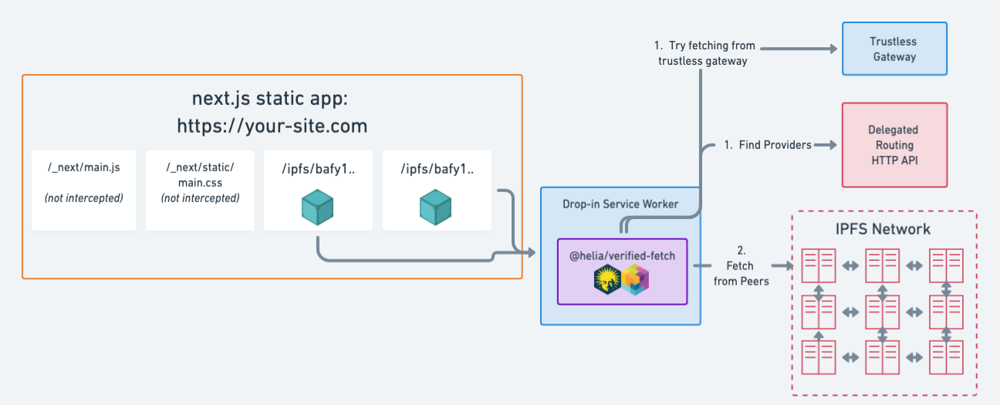

> [!IMPORTANT]
> **This project is no longer maintained.**
>
> The code still works, but it pins an old [@helia/verified-fetch](https://www.npmjs.com/package/@helia/verified-fetch) and will not be updated.
>
> If you are moving an application off public gateways, calling `@helia/verified-fetch` directly is usually the better starting point. [Replace public gateways with self-hosted IPFS](https://docs.ipfs.tech/how-to/replace-public-gateways-with-self-hosted-ipfs/) covers that path and the backend options alongside it.
>
> The repository can be unarchived, but only for a named maintainer who commits to keeping it up. If that is you, reach out to the [IPFS Foundation](https://ipfsfoundation.org/about/).

# IPFS Drop-in Service Worker Example

Replace centralized IPFS gateways with resilient and verified retrieval gateways or providers with [@helia/verified-fetch](https://www.npmjs.com/package/@helia/verified-fetch) in a drop-in Service Worker.

This example shows how to use a Service Worker to intercept requests to centralized IPFS gateways and retrieve content directly from providers (or self-hosted gateways) with [@helia/verified-fetch](https://www.npmjs.com/package/@helia/verified-fetch).

For more information, check out the [deep dive video on YouTube](https://www.youtube.com/watch?v=qtIJXRgxjVA&ab_channel=IPFS).

## Running

```bash
npm install
npm run dev
```

## Building

To build the static site, run:

```bash
npm run build
```

This will also build the Service Worker, which is output to `public/sw.js`.

The output directory for the static site is `out`.

## Architecture



## Service Worker

The Service Worker is defined in [sw/sw.ts](sw/sw.ts), and is built in a separate process using esbuild, because it's tricky getting an additional bundle without polluting Next.js config with custom Webpack config.

### Registration

The Service Worker is registered in the [`useServiceWorker` hook](hooks/use-service-worker.ts), and will be installed and activated [when the page loads](pages/_app.tsx).

To ensure that all IPFS Gateway requests are intercepted, rendering is blocked until the Service Worker is active.
